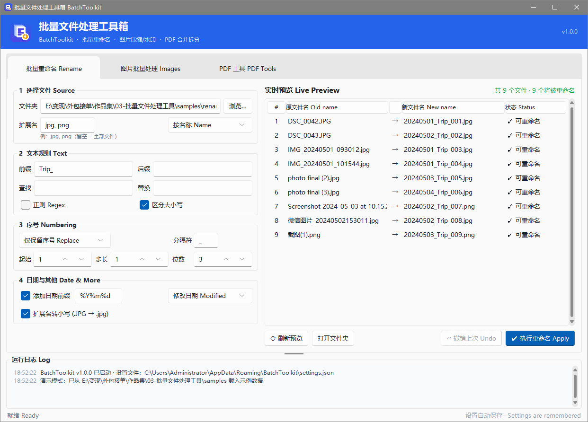
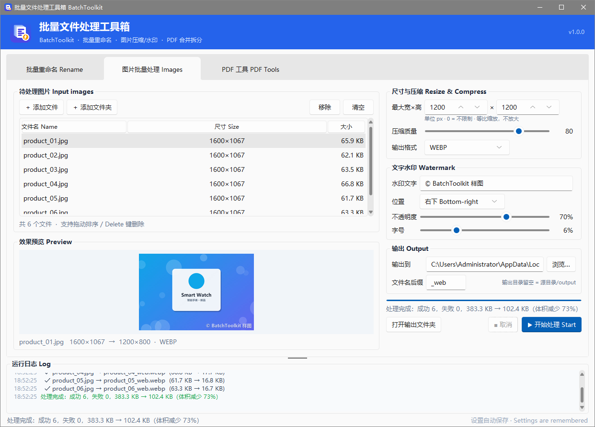
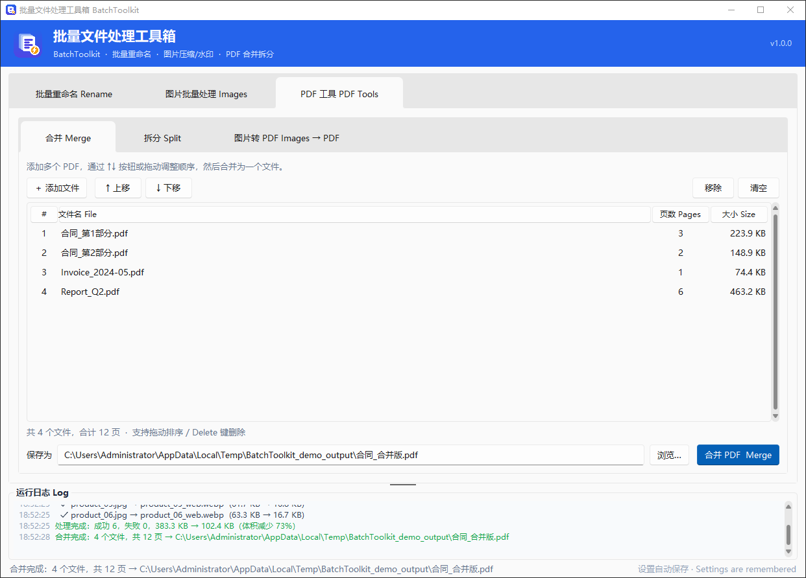
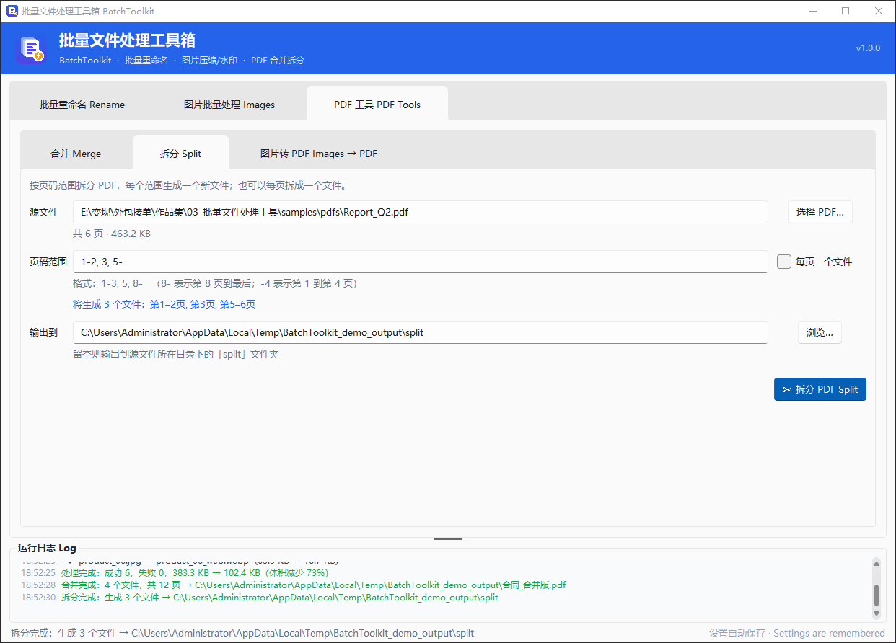
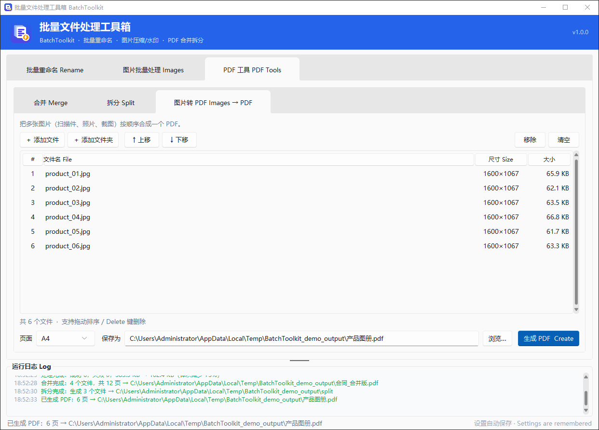
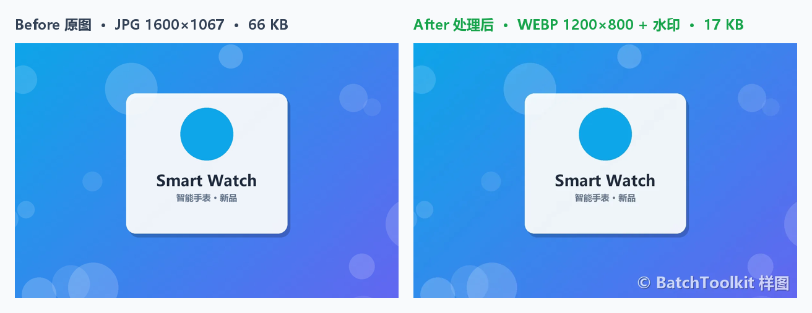

# BatchToolkit · 批量文件处理工具箱

**⬇️ Download / 下载：** [BatchToolkit.exe (Releases)](https://github.com/LiMarkss/batch-toolkit/releases/latest) — Windows 10/11, no install needed / 无需安装，双击运行

> A double-click Windows desktop app for everyday batch file chores: **batch rename with live preview & undo**, **image resize / compress / convert / watermark**, and **PDF merge / split / images → PDF**.
> 一款双击即用的 Windows 桌面工具：**批量重命名（实时预览 + 一键撤销）**、**图片批量压缩/转格式/加水印**、**PDF 合并/拆分/图片转 PDF**。



[English](#english) · [中文](#中文)

---

## English

### Features

| Module | What it does |
|---|---|
| **Batch Rename** | Prefix / suffix, sequence numbering (start, step, zero-padding, before/after/replace name), find & replace (plain or **regex**, case-(in)sensitive), date prefix (today or file-modified date, custom format), extension filter, lower-case extensions, sort by name (natural sort) or modified time. **Live preview table (old → new)** updates as you type. **Conflict detection** (duplicate targets, existing files/folders, invalid Windows names, reserved names) — conflicting rows turn red and Apply is blocked. **One-click Undo** using a JSON rename log. Safe two-phase renaming handles chains/swaps (`1→2, 2→3`) and case-only renames. |
| **Image Batch** | Resize to max width/height (keeps aspect ratio, never upscales), JPG/WEBP quality, convert to **JPG / PNG / WEBP** (or keep), text watermark (Chinese supported; 5 positions + tiled; opacity & size), EXIF orientation fix, output to a new folder with optional name suffix (never overwrites). **Live effect preview**, progress bar, cancel button — processing runs in a **background thread**, the UI never freezes. Summary shows total size saved. |
| **PDF Tools** | **Merge** many PDFs (reorder with ↑/↓ buttons or drag & drop, shows page counts). **Split** by page ranges like `1-3, 5, 8-` (with live "will create N files" preview) or one file per page. **Images → PDF** (original size or A4/Letter pages with auto portrait/landscape). |
| **App** | Run log with colored success/error lines, status bar, friendly error dialogs (corrupted / encrypted / locked files), all settings remembered between runs (`%APPDATA%\BatchToolkit\settings.json`), modern Sun-Valley (Windows 11 style) theme, HiDPI aware. |

### Screenshots

| | |
|---|---|
|  |  |
| Batch rename – live preview | Image batch – preview, progress, size savings |
|  |  |
| PDF merge – reorderable list | PDF split – page ranges |
|  |  |
| Images → PDF | Output example: 66 KB JPG → 17 KB WEBP + watermark |

### Run from source

```bash
pip install -r requirements.txt
python app.py                 # normal mode
python make_samples.py        # (optional) generate demo files in samples/
python app.py --demo          # open with sample data preloaded
```

Requires Python 3.10+ (developed on 3.12, Windows 10/11). Dependencies: Pillow, pypdf, sv-ttk.

### Build the .exe

```bash
python build.py --clean
# -> dist/BatchToolkit.exe   (single file, no console window, ~22 MB)
```

`build.py` generates the app icon and calls PyInstaller with
`--onefile --windowed --name BatchToolkit --icon assets/icon.ico --collect-data sv_ttk`.
The end user only needs the exe — no Python installation.

### Tests

```bash
python -m pytest -q
```

All business logic lives in `core/` (pure functions, no GUI) and is covered by **69 pytest tests** that create temporary files and verify: rename rules, preview/conflict detection, apply + undo round-trip, swap chains, case-only renames, image resize/convert/quality/watermark/cancel, PDF merge order, range parsing & errors, split, images → PDF (A4 orientation), settings persistence.

### Project structure

```
03-批量文件处理工具/
├── app.py              # tkinter GUI (tabs, threading, settings, demo/screenshot mode)
├── core/               # GUI-free, unit-tested logic
│   ├── rename.py       #   rules, preview plan, conflict detection, apply, undo log
│   ├── image.py        #   resize / compress / convert / watermark / batch
│   ├── pdf.py          #   merge / split / page ranges / images -> PDF
│   ├── settings.py     #   JSON settings in %APPDATA%
│   └── icon.py         #   programmatically drawn app icon
├── tests/              # pytest suite (69 tests)
├── samples/            # demo data (make_samples.py)
├── screenshots/        # README images (python app.py --screenshot screenshots)
├── build.py            # PyInstaller one-file build
├── make_samples.py
└── requirements.txt
```

### Can be customized for

- **Renaming by an Excel/CSV list** (old name → new name mapping, product SKU, employee ID…)
- **Invoice PDF processing** — split by invoice, extract invoice number/amount, rename PDFs by content, merge monthly reports
- **Watermarking product photos** for e-commerce (logo image watermark, square canvas for Taobao/Amazon, white background)
- Batch converting HEIC/RAW photos, resizing to platform presets (Shopee, Etsy, WeChat), generating thumbnails
- Organizing files into folders by date/type, removing duplicates, batch Excel/Word → PDF
- Command-line or scheduled versions of any of the above, or integration with your existing workflow

---

## 中文

### 功能

| 模块 | 说明 |
|---|---|
| **批量重命名** | 前缀/后缀、序号（起始值、步长、补零位数，可放在前面/后面/替换原名）、查找替换（普通或**正则**，可区分大小写）、日期前缀（今天或文件修改日期，格式可自定义）、扩展名过滤、扩展名转小写、按名称（自然排序）或修改时间排序。**实时预览表（原名 → 新名）**，边输入边更新。**冲突检测**：目标重名、文件/文件夹已存在、Windows 非法字符和保留名，冲突行标红并禁止执行。**一键撤销**（JSON 重命名日志）。采用两阶段重命名，安全处理 `1→2、2→3` 这类链式改名以及仅大小写变化。 |
| **图片批量处理** | 按最大宽/高等比缩放（不放大）、JPG/WEBP 压缩质量、转换为 **JPG / PNG / WEBP**（或保持原格式）、文字水印（支持中文，5 种位置 + 平铺，可调不透明度和字号）、自动校正 EXIF 方向、输出到新文件夹并可加文件名后缀（不会覆盖已有文件）。**效果实时预览**、进度条、可取消；处理在**后台线程**进行，界面不卡顿；完成后显示总共节省的体积。 |
| **PDF 工具** | **合并**多个 PDF（↑/↓ 按钮或直接拖动排序，显示页数）；**拆分**：按 `1-3, 5, 8-` 这样的页码范围拆分（实时提示将生成几个文件），或每页一个文件；**图片转 PDF**：原尺寸或 A4/Letter 页面，横图自动横向。 |
| **通用** | 彩色运行日志、状态栏、友好的错误提示（文件损坏/加密/被占用等）、所有设置自动记忆（`%APPDATA%\BatchToolkit\settings.json`）、Windows 11 风格 Sun-Valley 主题、高分屏适配。 |

### 截图

见上方 [Screenshots](#screenshots)：批量重命名、图片处理、PDF 合并、PDF 拆分、图片转 PDF，以及处理前后对比（66 KB JPG → 17 KB WEBP + 水印）。

### 从源码运行

```bash
pip install -r requirements.txt
python app.py                 # 正常模式
python make_samples.py        # （可选）在 samples/ 中生成示例文件
python app.py --demo          # 载入示例数据打开，方便体验
```

需要 Python 3.10+（开发环境 3.12，Windows 10/11）。依赖：Pillow、pypdf、sv-ttk。

### 打包 exe

```bash
python build.py --clean
# 生成 dist/BatchToolkit.exe（单文件、无控制台窗口，约 22 MB）
```

`build.py` 会自动生成程序图标，并以 `--onefile --windowed --name BatchToolkit` 参数调用 PyInstaller。最终用户只需要这个 exe，无需安装 Python。

### 测试

```bash
python -m pytest -q
```

所有业务逻辑都在 `core/`（纯函数、不依赖界面），由 **69 个 pytest 用例**覆盖：在临时目录中创建真实文件，验证重命名规则、预览与冲突检测、执行 + 撤销往返、链式改名、大小写改名、图片缩放/转换/压缩/水印/取消、PDF 合并顺序、页码解析与报错、拆分、图片转 PDF（A4 横竖向）、设置读写等。

### 可定制方向

- **按 Excel/CSV 清单批量改名**（旧名 → 新名对照表、商品货号、工号等）
- **发票 PDF 处理**：按发票拆分、识别发票号/金额、按内容重命名、按月合并报表
- **商品图批量加水印**：Logo 图片水印、淘宝/亚马逊主图正方形白底、统一尺寸
- HEIC/RAW 照片批量转换、按平台规格（Shopee、Etsy、微信）批量裁剪缩放、生成缩略图
- 按日期/类型自动归档文件、查找重复文件、Excel/Word 批量转 PDF
- 以上任意功能的命令行版、定时任务版，或对接您现有的工作流程

> 需要定制？欢迎联系，一般 1–3 天交付，附源码与使用说明。
> Need a custom version? Typical delivery 1–3 days, with source code and documentation.
